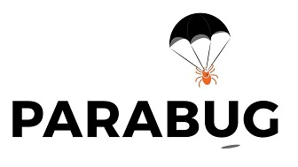

# Parabug Estimate Solution Tool



[Parabug website](https://parabug.xyz/)

## Table of Contents

- [Introduction](#introduction)
- [Capabilities](#capabilities)
- [Usage](#usage)
- [Local Development](#local-development)
- [Configuration](#configuration)
- [Testing](#testing)
- [Contributors](#contributors)
- [Acknowledgements](#acknowledgements)

## Introduction

The Parabug Estimate Solution Tool collects field boundaries, biological application rates, and customer information to prepare estimate requests. Users can define treatment areas on a map or attach a ranch map, review acreage and bug estimates, and email the request with generated reports.

The application supports desktop and mobile layouts. It uses Express and EJS, Google Maps with Terra Draw, JSTS geometry processing, PdfMake reports, and Nodemailer with Gmail OAuth2.

## Capabilities

### Map and Drawing Tools

- Draw an application boundary, hazard areas excluded from treatment, and variable rate areas with separate application rates.
- Calculate estimated treatment acreage and total bug counts from the drawn areas and selected rates.
- Cancel an unfinished cursor-drawn shape with a right-click without deleting completed areas.
- Use Drag and Delete modes to navigate the map or select areas for deletion.
- Draw using Crosshair mode on touch devices: position the crosshair, mark points, and finish the shape with the map controls.
- Customize application, hazard, and variable rate colors and opacity through Draw Settings.
- Search for locations using the expandable search field beside the Mode selector.
- Use fullscreen, map-display options, and controls for centering on drawings or overlays.

Create an application area before drawing hazards or variable rate areas. Completing a new application boundary replaces the existing drawing areas.

### Overlay Imports

Import reference layers through **Options > Import Overlay**. The import dialog provides expandable layer settings, layer removal, applicable tile sizing, and optional automatic or custom color palettes.

| Format | Purpose |
| --- | --- |
| `.kml` | Vector map geometry |
| `.kmz` | Supported packaged KML/image-overlay content |
| `.tif` | GeoTIFF raster overlays |
| `.zip` | Shapefiles with matching SHP and DBF files |
| `.json` | GeoJSON overlay data |

Imported layers have visibility and opacity controls and can be cleared independently of drawings. Variable rate auto generation can use colors from an imported overlay. Vector imports preserve their existing boundaries rather than using the raster tile-size setting.

An overlay is not a session backup. Importing the emailed KML as an overlay does not restore form entries or automatically turn placemark names into editable application and hazard drawing roles.

### Application Request Form

- Configure one or two bugs, bugs per acre, and variable application rates.
- Review read-only estimated acreage and comma-formatted total bug counts.
- Enter contact details, billing address, crop, row spacing, and ranch name.
- Supply manual acreage, a preferred application date, an operator preference, and notes.
- Attach a JPEG, PNG, or PDF ranch map instead of, or alongside, a drawn application area. The documented upload limit is 10 MB.

Manual acreage is an alternative estimate basis; hazard and variable rate adjustments are not incorporated into the manual-acreage estimate. It does not replace the submitted map geometry.

### Session Backups

Use **Session > Save** to download a JSON backup of drawn application, hazard, and variable rate areas plus form entries. Use **Session > Import** to resume a saved session.

Session backups do not include imported overlays or ranch-map attachments. Re-import or reattach those files when resuming work. Session Import accepts the application's session JSON structure, not arbitrary JSON, GeoJSON, or KML.

### Reports and Email

A successful submission sends two messages:

| Recipient | Contents |
| --- | --- |
| Client's Contact Email | Request confirmation with the generated PDF report |
| Configured business mailbox | Request details and PDF, plus KML/CSV exports when drawings exist and the ranch-map attachment when supplied |

KML and CSV attachments are exports of application data, not full session backups. The client confirmation is sent first; the business notification follows if that succeeds. A later failure can occur after the first message has already been sent.

### Built-in Help

The Help dialog contains Drawing, Files, Form fields, and Shortcuts topics. Selecting a help-enabled form label opens the matching explanation with a light orange border. Help supports keyboard tab navigation, Escape to close, and mobile scrolling. Import progress and result messages appear as responsive toasts.

## Usage

1. Define an application area on the map, or prepare a ranch-map attachment.
2. Add hazards and variable rate areas as needed. Import reference overlays separately through Options.
3. Configure bug rates and review the calculated estimates.
4. Complete the contact and application fields and add any preferences or attachments.
5. Save a session JSON backup if you need to resume later.
6. Submit the request when ready to send the client and business emails.

### File Entry Points

| Action | Accepted files | Result |
| --- | --- | --- |
| Session > Import | Saved session `.json` | Restores drawing and form data |
| Options > Import Overlay | `.kml`, `.kmz`, `.tif`, shapefile `.zip`, GeoJSON `.json` | Adds reference map layers |
| Ranch Map field | JPEG, PNG, PDF | Attaches a ranch map to the request |

### Keyboard Shortcuts

Use these keys with the map focused, not while typing into an input.

| Key | Action |
| --- | --- |
| `1` | Drag mode |
| `2` | Application area |
| `3` | Hazard area |
| `4` | Variable rate area |
| `5` | Delete mode |
| `6` | Variable rate auto generation; requires an imported overlay |
| `T` | Toggle Crosshair mode |
| `S` | Mark/select in Crosshair mode |
| `F` | Finish a shape in Crosshair mode |

Right-click cancels an unfinished cursor-drawn shape and leaves the drawing tool active for a new shape.

## Local Development

Use Node.js 26.13.0 or a newer 26.x release; the package requires Node.js `>=26.13.0 <27` and specifies npm 12.2.2. With nvm installed:

```powershell
nvm install 26.13.0
nvm use 26.13.0
npm install
if (-not (Test-Path .env)) { Copy-Item .env.example .env }
npm start
```

Before running `npm start`, configure the environment settings below. Open <http://localhost:3000/> after the server starts. The Google Maps key must permit the local origin and have the Maps/Places access needed by the integration.

## Configuration

The start command loads the root `.env` file when present. Existing process environment variables take precedence. See [.env.example](.env.example) for placeholder values.

| Variable | Purpose |
| --- | --- |
| `GOOGLE_MAPS_API_KEY` | Google Maps browser API key; restrict it to approved website origins |
| `GMAIL_USER` | Authenticated Gmail/Workspace mailbox and sender for both messages |
| `GMAIL_CLIENT_ID` | Google OAuth client ID |
| `GMAIL_CLIENT_SECRET` | Secret for that OAuth client |
| `GMAIL_REFRESH_TOKEN` | Refresh token issued to that client by the authorized sending mailbox |
| `PARABUG_EMAIL` | Business notification recipient; defaults to `GMAIL_USER` when unset or empty |

Gmail SMTP OAuth requires the `https://mail.google.com/` scope. Nodemailer obtains access tokens automatically from the refresh token. External Google OAuth apps in Testing issue Gmail refresh tokens that expire after seven days; production audience and authorization requirements must be configured separately. See [Google's token-expiration documentation](https://developers.google.com/identity/protocols/oauth2#expiration) and [Nodemailer's OAuth2 guidance](https://nodemailer.com/smtp/oauth2).

Keep `.env`, downloaded client secrets, and OAuth tokens private and out of source control. The `private/` folder is Git-ignored, not a secure secret store. Never include credentials in screenshots or diagnostics. Restart Node after changing environment settings.

## Testing

Run the automated suite from the project root:

```powershell
npm test
```

The current tests cover page rendering, bundled map/geometry assets, invalid application geometry, unsupported ranch-map attachments, and PDF generation. They do not verify live Google Maps behavior, OAuth credentials, or real email delivery.

For live local email testing, use a separate test mailbox and matching OAuth credentials. Set `GMAIL_USER`, `PARABUG_EMAIL`, and the form's Contact Email to your controlled test mailbox. Use fictional request data. A successful form submission sends **two real emails**; verify recipients before submitting and check the inbox before retrying a failed request.

## Contributors

 + [Christopher Williams](https://github.com/ChristopherLeeWilliams)
 + [Christian Martinez](https://github.com/chrisumartinez)
 + [Shaikh Sultani](https://github.com/shsultani)

## Acknowledgements

We would like to thank Chandler Bennett and Parabug for their support!
